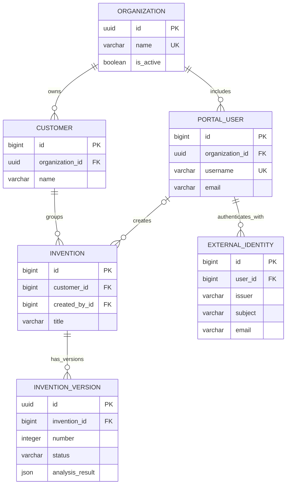

# Data Tables and Stored Structures

This document describes the persistent data used by the application and what each structure is for. The project does not store everything in one database:

1. **Django relational database** — organizations, users, customers, inventions, versions, analysis JSON, and file paths.
2. **Audit SQLite database** — model-call audit records.
3. **Chroma vector store** — CPC classification text and embeddings for semantic retrieval.
4. **Filesystem** — uploaded IDFs, generated DOCX reports, and persistent Chroma files.

The relational table names below are Django's default names based on the app and model names. The physical types are adapted by Django to the selected database engine (SQLite by default; PostgreSQL when `DATABASE_URL` is set).

## Relationship overview

An invention’s organization is determined through its customer (`Invention → Customer → Organization`). A version belongs to an invention. There is no separate organization ID column on the invention or version tables.

## Django application tables

### `accounts_organization`

Defined by `web_portal/accounts/models.py` (`Organization`). One row represents a client organization/tenant.

| Column | Logical type | Purpose |
|---|---|---|
| `id` | UUID, primary key | Stable organization identifier. |
| `name` | Text up to 160 characters, unique | Organization display name; unique across organizations. |
| `address` | Text | Optional postal/contact address. |
| `contact_person` | Text up to 160 characters | Optional primary contact name. |
| `subscription_type` | Text up to 80 characters | Optional plan or subscription label. |
| `starts_at` | Date, nullable | Optional subscription/start date. |
| `ends_at` | Date, nullable | Optional subscription/end date. |
| `is_active` | Boolean | Whether the organization is active. Defaults to true. |
| `created_at` | Date/time | Creation timestamp. |
| `updated_at` | Date/time | Last update timestamp. |

### `accounts_portaluser`

Defined by the custom `PortalUser` model in `web_portal/accounts/models.py`. It extends Django's `AbstractUser`; it therefore includes the standard user columns as well as the custom organization relationship.

| Column(s) | Logical type | Purpose |
|---|---|---|
| `id` | Big integer, primary key | Django-generated user ID. |
| `username` | Text up to 16 characters, unique | Portal login name. |
| `password` | Text | Django password hash; raw passwords are not stored. |
| `email` | Email/text | User email address. |
| `first_name`, `last_name` | Text | Standard Django user profile fields. |
| `is_active`, `is_staff`, `is_superuser` | Boolean | Account status and Django admin privileges. |
| `last_login`, `date_joined` | Date/time | Standard Django account timestamps. |
| `organization_id` | UUID foreign key, nullable | Organization the user belongs to. `PROTECT` prevents deleting an organization while users reference it. It can be empty for a Django superuser. |

Django also creates many-to-many join tables for user groups and permissions: `accounts_portaluser_groups` and `accounts_portaluser_user_permissions`. These connect users to `auth_group` and `auth_permission`; the user model does not store all group/permission IDs in a single field.

### `accounts_externalidentity`

Stores a provider identity linked to a portal profile. Google sign-in records the OIDC issuer and stable subject (`sub`), along with the verified provider email. The issuer/subject pair is unique so a Google identity cannot be linked to multiple users. Provider tokens are not stored; Django creates its usual session after sign-in.

### `accounts_emaillogincode`

Stores temporary email verification/sign-in challenges. The email, password-hashed code, expiry time, attempt count, requesting IP, and consumption timestamp support one-time use, expiry, and throttling. The code itself is not persisted. New email users receive a personal workspace after successful verification; existing accounts sign in to their already assigned organization.

### `patents_customer`

Defined by `Customer` in `web_portal/patents/models.py`. Customers are records within an organization; an organization can have multiple customers.

| Column | Logical type | Purpose |
|---|---|---|
| `id` | Big integer, primary key | Customer record ID. |
| `organization_id` | UUID foreign key | Owner organization; required. `PROTECT` prevents deleting an organization that still has customers. |
| `name` | Text up to 160 characters | Customer/client name. |
| `created_at`, `updated_at` | Date/time | Record timestamps. |

Constraint: `(organization_id, name)` must be unique, so two organizations may use the same customer name, but one organization cannot create the same name twice.

### `patents_invention`

Defined by `Invention` in `web_portal/patents/models.py`. It groups one invention under a customer.

| Column | Logical type | Purpose |
|---|---|---|
| `id` | Big integer, primary key | Invention record ID. |
| `customer_id` | Big integer foreign key | Customer that owns/groups the invention. `PROTECT` prevents deleting a customer that has inventions. |
| `created_by_id` | Nullable user foreign key | User who created the record. `SET_NULL` preserves the invention if that user is deleted. |
| `title` | Text up to 20 characters | Invention title. |
| `created_at`, `updated_at` | Date/time | Record timestamps. |

The displayed invention number, such as `INV-000123`, is generated from the database ID by a model property; it is not a separate stored column.

### `patents_inventionversion`

Defined by `InventionVersion` in `web_portal/patents/models.py`. Each upload/analysis attempt is a version, preserving earlier IDF files and their results.

| Column | Logical type | Purpose |
|---|---|---|
| `id` | UUID, primary key | Public/stable identifier for the version and report-download route. |
| `invention_id` | Big integer foreign key | Parent invention. `CASCADE` deletes its versions if the invention is deleted. |
| `number` | Positive integer | Version number within that invention. |
| `status` | Text up to 16 characters | `processing`, `completed`, or `failed`. Defaults to `processing`. |
| `idf_file` | File path text | Relative storage path for the uploaded `.txt` IDF; the file itself is stored on disk, not inside this column. |
| `analysis_result` | JSON | Structured result returned by FastAPI, including graph outputs such as invention features, keywords, CPC analysis, patent queries, and NPL results. Defaults to an empty object. |
| `report_path` | Text | Path to the generated DOCX report. |
| `error_message` | Text | Analysis failure details, if any. |
| `created_at` | Date/time | When this version was created. |
| `completed_at` | Nullable date/time | When analysis finished, if it completed. |

Constraint: `(invention_id, number)` is unique. This prevents duplicate version numbers for one invention.

## Django framework tables

Django creates and manages additional tables needed for authentication, permissions, migrations, sessions, and the admin site. The exact set is determined by installed Django apps and migrations. Common tables in this project include:

| Table(s) | Purpose |
|---|---|
| `auth_group`, `auth_permission`, `auth_group_permissions` | Django groups and permissions. |
| `accounts_portaluser_groups`, `accounts_portaluser_user_permissions` | Many-to-many links from portal users to groups and individual permissions. |
| `django_content_type` | Registry of installed Django model types, used by permissions and admin. |
| `django_migrations` | Records which schema migrations have been applied. |
| `django_session` | Django login/session data. |
| `django_admin_log` | Change history for records edited through Django admin. |

These are framework-managed tables; they are not defined in the `Customer`, `Invention`, or `Organization` model classes.

## Separate audit table

### `audit_log` table

Defined with SQLAlchemy in `services/utils.py`. Locally it defaults to a SQLite file named `patent_agent.db` relative to the FastAPI process's working directory. In production it uses `AUDIT_DATABASE_URL` when set, otherwise it falls back to `DATABASE_URL`, so audit rows are stored in the same PostgreSQL database as portal records.

| Column | Logical type | Purpose |
|---|---|---|
| `id` | String(36), primary key | UUID encoded as text. |
| `session_id` | String(100), indexed | Graph/session identifier used to associate records with an analysis run. |
| `calling_function` | String(200) | Graph/model operation name. |
| `query` | Text, nullable | Prompt or query sent to the operation. |
| `answer` | Text, nullable | Serialized result/response. |
| `datetime` | Timezone-aware date/time | When the audit record was written. |

`AuditService.log_model_call()` writes model-call entries. Tool/error helper methods currently print to the process output rather than inserting rows into `audit_log`.

## CPC vector collection (Chroma)

This is not a relational SQL table. The active bootstrap opens the Chroma collection `cpc_patent_classification` under `./data/chroma_db/full_cpc_db`.

| Stored component | Purpose |
|---|---|
| Vector record ID | CPC code normalized as `clean_id`; identifies a classification record. |
| Document text | `rag_content`, containing the CPC code and the classification's textual context, used for semantic retrieval. |
| Metadata `cpc_code` | Original CPC symbol/code returned to the analysis logic and report. |
| Metadata `title` | CPC title/label used for display and relevance analysis. |
| Embedding | Numeric vector generated from the document text; used to find candidate CPC records for invention queries. |

`ingestion/1-cpc_to_csv.py` produces the intermediate CSV columns `clean_id`, `raw_symbol`, `title`, and `rag_content`. `ingestion/2_cpc_full_ingestion.py` turns those rows into Chroma documents, metadata, IDs, and embeddings. The runtime CPC search is performed by `graph/nodes.py` using the vector store initialized in `bootstrap/bootstrap.py`.

## LangGraph state and NPL record structures

`PatentState` in `config/state.py` is an in-memory typed structure passed between graph nodes; it is **not** a SQL table. It carries fields including `idf_text`, `invention`, `keywords`, `cpc_analysis`, `uspto_queries`, `espacenet_queries`, `npl_queries`, `npl_results`, and `npl_search_summary`.

The portal persists the final graph output in `patents_inventionversion.analysis_result` as JSON. The report is also generated as a DOCX file; the database stores its path in `report_path` rather than storing the DOCX bytes in a database column.

NPL records within the JSON include bibliographic data such as title, authors, publication date, abstract, DOI, venue, provider, source link, searched feature IDs, and relevance/ranking fields when available. Provider diagnostics are stored alongside the records in `npl_search_summary`.

The graph currently compiles with LangGraph's in-memory `MemorySaver` checkpointer in `graph/graph_builder.py`. That checkpointer is a runtime memory structure, not a database table; the report and portal JSON persistence are separate mechanisms.

## Where schema changes are made

- Django table definitions: `web_portal/accounts/models.py` and `web_portal/patents/models.py`.
- Django schema history: each app's `migrations/` directory. After model changes, generate/apply migrations with `web_portal/manage.py makemigrations` and `web_portal/manage.py migrate`.
- Audit table definition: `AuditLog` in `services/utils.py`; it is created with SQLAlchemy `Base.metadata.create_all()` during FastAPI bootstrap.
- Chroma document/metadata shape: `ingestion/1-cpc_to_csv.py` and `ingestion/2_cpc_full_ingestion.py`.
- LangGraph's runtime data shape: `config/state.py`; node outputs are implemented in `graph/nodes.py` and `graph/npl_search.py`.

## Database locations and backend selection

- Django defaults to `web_portal/portal.sqlite3` when `DATABASE_URL` is unset. The settings also support a PostgreSQL URL.
- Audit logging defaults to SQLite locally and uses PostgreSQL in production through `DATABASE_URL` (or an explicit `AUDIT_DATABASE_URL` override).
- CPC vectors are stored under `data/chroma_db/full_cpc_db`.
- Uploaded IDF files and DOCX reports are stored on the filesystem at configured media/report roots; database rows keep their paths.
